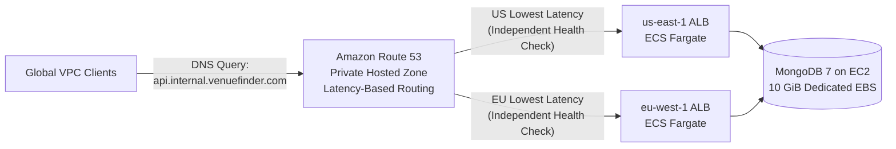

# Global VenueFinder — Multi-Region Event Space Marketplace on AWS Route 53

An "Airbnb for Event Spaces" full-stack monorepo engineered for stateless multi-region deployment on **AWS ECS Fargate (`us-east-1` & `eu-west-1`)** behind **Amazon Route 53** Latency-Based Routing, independent active health checks, and a persistent MongoDB tier.

---

## 🌐 Amazon Route 53: Global DNS & Traffic Management

Amazon Route 53 serves as the global traffic control plane for **Global VenueFinder**, translating human-readable domains (`api.internal.venuefinder.com`) into regional Application Load Balancer targets with automated fault tolerance.



### Why Amazon Route 53?
- **High Availability & Scalability:** Global anycast DNS network backed by a 100% availability SLA with zero manual scaling.
- **Intelligent Traffic Management:** Latency-Based, Failover, Geolocation, and Weighted routing policies.
- **Active Health Checks & Failover:** Continuous `GET /health` probes across each regional ALB verify the entire stack (ALB $\rightarrow$ ECS Fargate $\rightarrow$ MongoDB `admin().ping()`). Unhealthy regions are automatically evicted from DNS answers.
- **Private Hosted Zones (`internal.venuefinder.com`):** Splits internal service discovery across multiple regional VPCs (`us-east-1` + `eu-west-1`) without exposing internal DNS records to the public internet or incurring domain registration overhead.

### How We Implemented Route 53 (4-Step Breakdown)
1. **VPC DNS Support:** Enabled `enableDnsSupport` and `enableDnsHostnames` on both the US and EU VPCs so internal AmazonProvidedDNS resolvers can query private zones.
2. **Multi-VPC Private Hosted Zone:** Provisioned `internal.venuefinder.com` and associated it with both `us-east-1` and `eu-west-1` VPCs.
3. **US Latency Record & Health Check:** Created an `A` Alias record for `api.internal.venuefinder.com` (`us-east-1`) targeting the US ALB with its own `/health` check.
4. **EU Latency Record & Independent Health Check:** Created the paired `A` Alias record (`eu-west-1`) targeting the EU ALB with a **separate, independent health check**—eliminating single-point-of-failure blast radiuses where a US outage would evict the healthy EU record.

> 📖 **Read the full SRE deep-dive (including AWS CLI UI-bug bypasses & the Inverted Health Check trap):**  
> [**Phase 4 (Part 2): Amazon Route 53 Case Study**](docs/case-studies/phase-04-part2-route53.md)

---

## 📚 Cloud Engineering Case Studies & Decision Log

| Phase | Document | Scope & Highlights |
| :--- | :--- | :--- |
| **Overview** | [00-project-overview.md](docs/case-studies/00-project-overview.md) | End-to-end cloud topography, integer-cents ledger, double-booking guard, & SRE post-mortems |
| **Phase 2** | [phase-02-mongodb-ec2.md](docs/case-studies/phase-02-mongodb-ec2.md) | MongoDB 7 in Docker on EC2, 10 GiB EBS decoupling, UUID `fstab`, & AZ troubleshooting |
| **Phase 3** | [phase-03-ecr-ecs.md](docs/case-studies/phase-03-ecr-ecs.md) | Private ECR, ECS Fargate `us-east-1`, IAM execution roles, & Security Group mismatch RCA |
| **Phase 4 (Part 1)** | [phase-04-part1-load-balancing.md](docs/case-studies/phase-04-part1-load-balancing.md) | Dual-region ALBs (`us-east-1` & `eu-west-1`), Target Groups, & EU Fargate deployment |
| **Phase 4 (Part 2)** | [phase-04-part2-route53.md](docs/case-studies/phase-04-part2-route53.md) | **Route 53 Private Hosted Zone, Latency-Based Routing, Independent Health Checks, & CLI Fixes** |
| **ADRs** | [docs/decisions/README.md](docs/decisions/README.md) | Architecture Decision Records (Route 53, EBS persistence, ECR naming, Private DNS) |

---

## Repository Structure

```
.
├── route-53-backend/      # Express + TypeScript + Mongoose + Zod (scaffolded via CEM CLI)
├── route-53-frontend/     # Next.js (App Router) + TypeScript + Tailwind CSS + Zod
├── docs/
│   ├── case-studies/      # Detailed phase-by-phase cloud implementation & SRE post-mortems
│   ├── decisions/         # Architecture Decision Records (ADRs)
│   └── screenshots/       # Verified AWS Console & CLI evidence across all phases
└── docker-compose.yml     # Local orchestration: frontend + backend + MongoDB with named volume
```

---

## Quick Start (Docker Compose)

1. Copy `.env.example` to `.env` in both apps:
   ```bash
   cp route-53-backend/.env.example route-53-backend/.env
   cp route-53-frontend/.env.example route-53-frontend/.env
   ```
2. Launch the full stack:
   ```bash
   docker-compose up --build
   ```
3. Access the services:
   - **Frontend Web App:** `http://localhost:3000`
   - **Backend API:** `http://localhost:5000/api`
   - **Route 53 Health Check Endpoint:** `http://localhost:5000/health`

### Pre-Seeded Demo Accounts

When the backend connects to an empty MongoDB database, it automatically seeds 6 global venues and two demo accounts:
- **Demo Renter:** `renter@venuefinder.global` / `Password123!`
- **Demo Host:** `host@venuefinder.global` / `Password123!`

---

## Key Application Architecture Highlights

- **Stateless Multi-Region Backend:** No in-memory sessions or local filesystem state. JWT authentication is delivered via `httpOnly` cookies (`accessToken` + `refreshToken`) and `Bearer` headers.
- **Route 53 Active Health Check (`GET /health`):** Verifies `mongoose.connection.readyState === 1` and executes an active `admin().ping()` against MongoDB, returning `200 OK` when healthy and `503 Service Unavailable` when MongoDB is unreachable.
- **Server-Side Double-Booking Prevention:** Combines a MongoDB partial unique index on active timeslots with pre-insert and post-insert atomic overlap verification (`status: { $in: ['pending', 'confirmed'] }`, `startTime < end`, `endTime > start`), rejecting conflicts with `409 CONFLICT`.
- **Minor-Unit Currency Precision:** All monetary values (`pricePerHour`, `totalPrice`) are stored and transmitted as integers in cents.
- **Standardized Error & Pagination Contracts:**
  - Errors return `{ "error": { "code": string, "message": string } }` without leaking stack traces in production.
  - Paginated endpoints accept `?page=&limit=` and return `{ data, page, limit, total }`.
