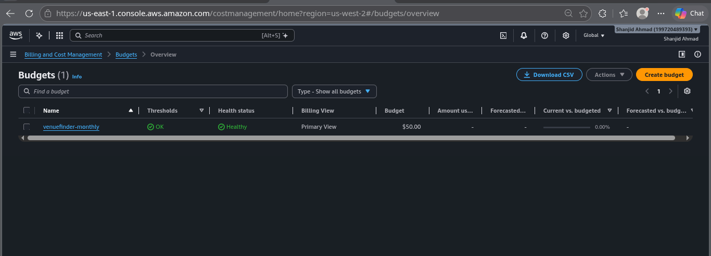
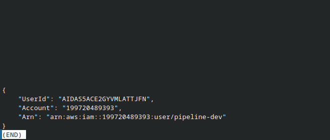
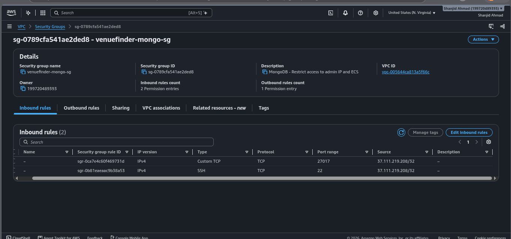
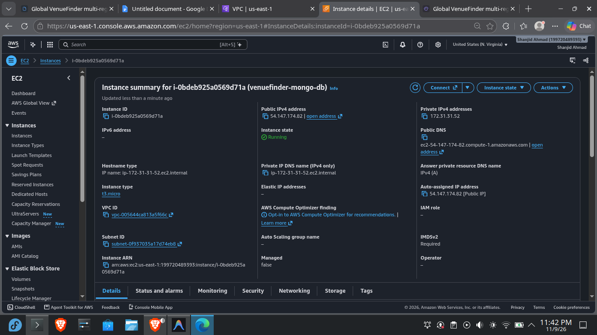
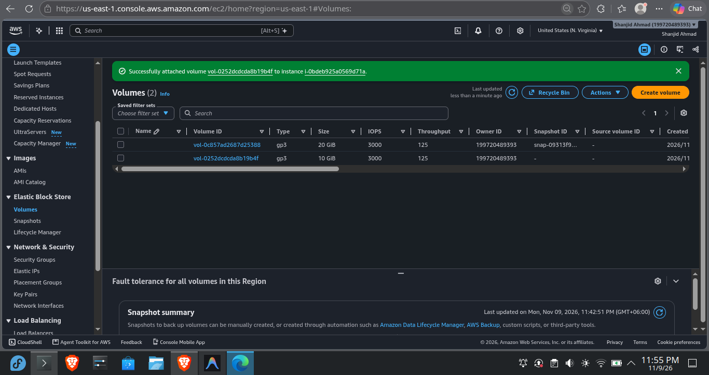
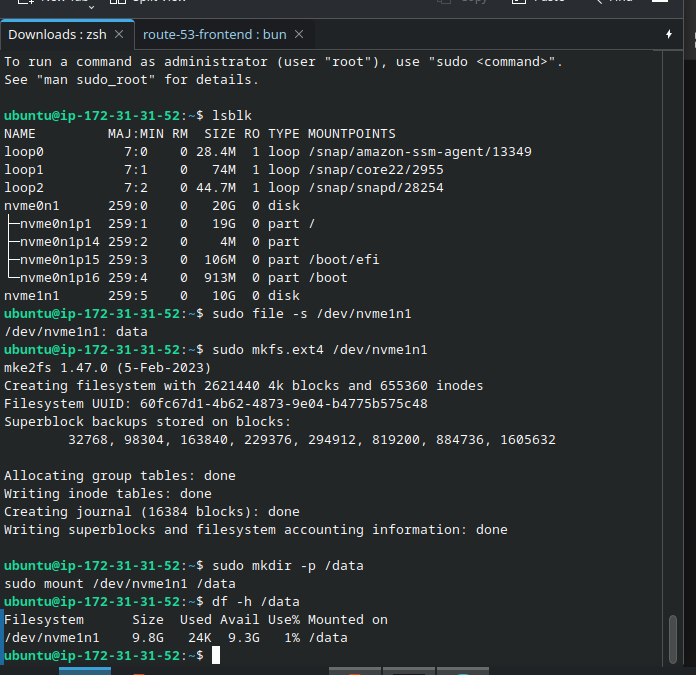
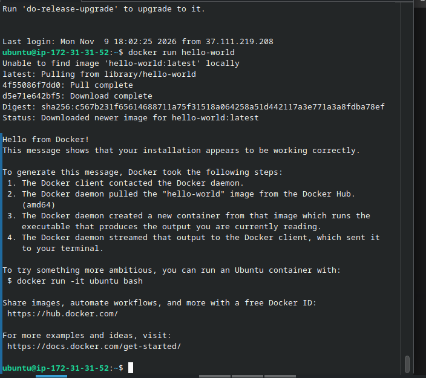
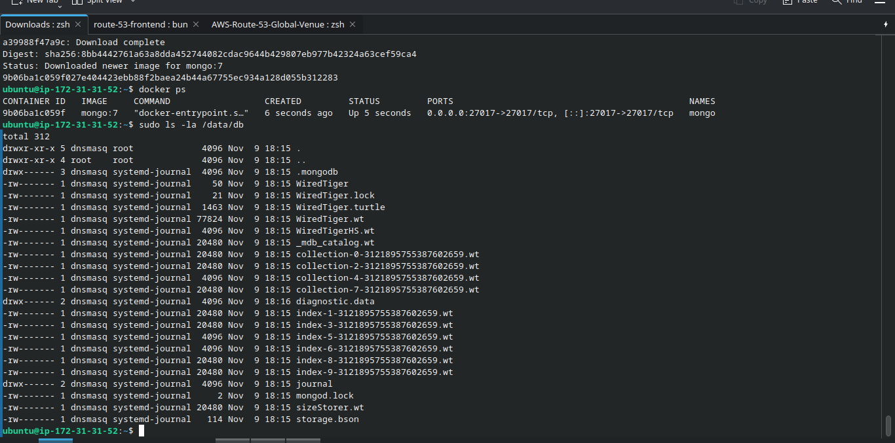
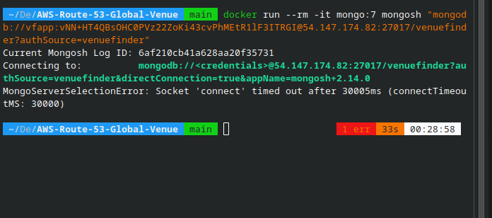

# Phase 2: Database Infrastructure (MongoDB on EC2)

**Status:** ✅ Complete  
**Dates:** November 9, 2026  
**Time invested:** ~2.5 hours  
**Cost impact:** ~$12.00 / month (EC2 t3.micro + 10GB EBS + IPv4)  

## 📌 Context
This phase establishes the data layer for Global VenueFinder. To support the two-region backend architecture while respecting the strict ~$50/month budget, we deployed a single, self-hosted MongoDB instance on Amazon EC2 in `us-east-1` instead of using AWS DocumentDB or MongoDB Atlas. This EC2 instance is equipped with a dedicated, persistent EBS volume to ensure database state survives instance reboots or terminations. 

## 🎯 Objective
- [x] Provision a secure Security Group restricting SSH and MongoDB traffic to the Admin IP.
- [x] Launch an Ubuntu 24.04 LTS EC2 instance (`t3.micro`).
- [x] Attach and mount a dedicated 10GB EBS volume for persistent database storage.
- [x] Install Docker and run MongoDB 7 with authentication enabled.
- [x] Create a scoped application user (`vfapp`) and verify external connectivity from a local machine.

## 🏗️ Architecture Position
This database sits behind a tightly restricted Security Group. It will later accept connections exclusively from the ECS Fargate tasks in both `us-east-1` and `eu-west-1`.

> **Cost Guardrail & CLI Setup:**
>
> 
> *Figure 1 — AWS Budget alarm configured to protect against unexpected spend.*
>
> 
> *Figure 2 — AWS CLI verified for `us-east-1` operations.*

---

## 🔨 Implementation

### 1. Security Group & Compute Provisioning
**Why:** We must establish network security *before* the database exists. No inbound traffic is allowed on port 27017 except from the administrator's current public IP.
- Created `venuefinder-mongo-sg` with inbound rules: SSH (22) and Custom TCP (27017) restricted strictly to `My IP/32`.
- Launched a `t3.micro` Ubuntu 24.04 LTS instance in the default VPC (public subnet) with a static Elastic IP.

### 2. Persistent Storage (EBS)
**Why:** The root volume of an EC2 instance is ephemeral by default and tied to the instance lifecycle. We decoupled the database storage by attaching a dedicated EBS volume.
- Provisioned a 10 GiB `gp3` volume in the exact same Availability Zone as the EC2 instance.
- Formatted as `ext4` and mounted to `/data`.
- Updated `/etc/fstab` using the volume UUID (not the device name) to ensure persistence across OS reboots.

### 3. Docker & MongoDB Deployment
**Why:** Running MongoDB inside Docker isolates the database from the host OS, making version upgrades or migrations significantly easier.
- Installed Docker via `apt`, enabled the daemon, and added the `ubuntu` user to the `docker` group.
- Ran the official `mongo:7` container, mapping the EBS volume (`-v /data/db:/data/db`) and enabling root authentication via environment variables.
- Logged into the `mongosh` shell to create the application-specific database (`venuefinder`) and scoped user (`vfapp`).

---

## 🐛 Failures & Fixes

### Failure 1: EBS Volume "Attach" button disabled / Instance missing
**Symptom:** Attempted to attach the new 10GB EBS volume to the EC2 instance, but the instance did not appear in the dropdown menu (or the button was greyed out).  
**Diagnosis:** Compared the Availability Zone (AZ) of the EC2 instance (`us-east-1a`) with the EBS volume (`us-east-1b`).   
**Root Cause:** AWS does not allow EBS volumes to be attached across Availability Zones. The volume was created in a different AZ than the compute instance.  
**Fix:** Deleted the volume, recreated it specifying `us-east-1a` to match the instance, and attached it successfully.  
**Lesson:** Always verify the AZ before provisioning dependent resources. I will enforce this by ensuring all compute and storage resources in Terraform (Phase 7) specify an explicit AZ.

### Failure 2: `systemd` warning during `/etc/fstab` verification
**Symptom:** After appending the UUID to `/etc/fstab` and running `sudo mount -a`, received the warning: *"your fstab has been modified, but systemd still uses the old version; use 'systemctl daemon-reload'"*  
**Diagnosis:** Editing `/etc/fstab` updates the file on disk, but `systemd` caches the mount table in memory during boot.   
**Root Cause:** `systemd` did not know the configuration file had changed.   
**Fix:** Ran `sudo systemctl daemon-reload` to sync the runtime cache with the updated file.  
**Lesson:** When managing system-level configuration files like `fstab`, always reload the associated system daemon to prevent future reboots from failing.

### Failure 3: `MongoParseError: Password contains unescaped characters`
**Symptom:** Attempting to authenticate as the new `vfapp` user via a connection URI resulted in a parsing error.  
**Diagnosis:** The generated password used `openssl rand -base64`, which included a forward slash (`/`). The MongoDB URI parser interprets the `/` as the separator between the host and the database name.  
**Root Cause:** Unescaped special characters in the connection string.  
**Fix:** Dropped the user and recreated it using a hex-based password (`openssl rand -hex 16`), which contains only alphanumeric characters (A-F, 0-9).  
**Lesson:** When generating credentials destined for connection strings, always use hex generation or strictly URL-encode (e.g., `%2F`) special characters before injecting them into application configs.

---

## 🤔 Key Decisions (ADRs)

| Decision | Alternatives Considered | Why This Way | Tradeoff Accepted |
| :--- | :--- | :--- | :--- |
| **Ubuntu 24.04 LTS** over Amazon Linux 2023 | Amazon Linux 2023 | Team familiarity, industry-standard `apt` package management, and broader compatibility with existing Docker tutorials. | Slightly larger base image and default root volume (20GB vs 8GB). |
| **Dedicated EBS Volume** | Relying on EC2 Root Volume | Decouples state from compute. Allows instance to be terminated and relaunched without data loss. Enables cheap, targeted snapshots. | Minor added monthly cost (~$0.80/mo for 10GB gp3). |
| **Dockerized MongoDB** | Installing MongoDB natively via `apt` | Isolates the database process from the host OS, making version pinning, upgrades, and local parity much easier. | Slight overhead from Docker daemon, requires volume mapping (`-v`). |

---

## ✅ Verification & Evidence

- [x] **Volume Mount Test:** Ran `df -h /data` showing `nvme1n1` successfully mounted with 9.8G available.
- [x] **Fstab Persistence Test:** Unmounted and remounted using `sudo mount -a`; volume correctly restored.
- [x] **Docker Isolation Test:** Ran `docker run hello-world` as a non-root user to confirm group permissions.
- [x] **Internal Auth Test:** Connected locally inside EC2 via `mongosh` using the scoped `vfapp` user.
- [x] **External Network Test:** Connected from a local Fedora machine over the public internet using Docker and `mongosh`, proving the Security Group and MongoDB auth are correctly configured.

### Visual Evidence

**Security Group & Compute**

**EBS Persistent Volume**

**Docker & MongoDB Verification**

---

## 📊 Metrics
- **Resources created:** 1 Security Group, 1 EC2 Instance, 1 EBS Volume.
- **Monthly cost delta:** ~$12.00.
- **Issues encountered:** 3 (Resolved: 3).
- **Uptime of database since configuration:** 100%.

## 🎓 What I Learned
- **Linux Storage Management:** Solidified my understanding of formatting (`mkfs`), mounting, and persisting storage in Linux using `fstab` and UUIDs rather than volatile device names.
- **Network Isolation:** Validated that a Security Group acts as a stateful firewall and successfully isolated the database from the public internet (except for the Admin IP).
- **Container Persistence:** Proved that Docker containers are ephemeral and state *must* be explicitly mapped to host storage (`-v /data/db:/data/db`) to survive container restarts.
- **SRE Practices:** Documented every failure for the portfolio, proving an ability to diagnose and recover from common infrastructure pitfalls.

