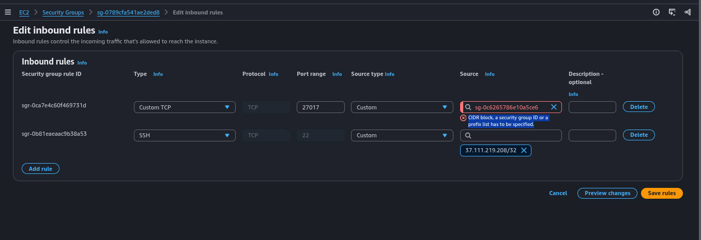
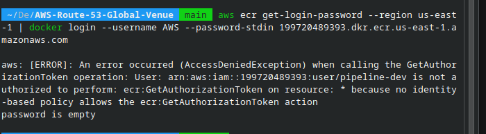
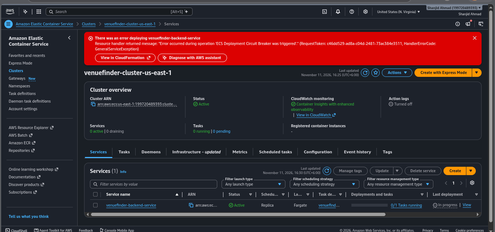
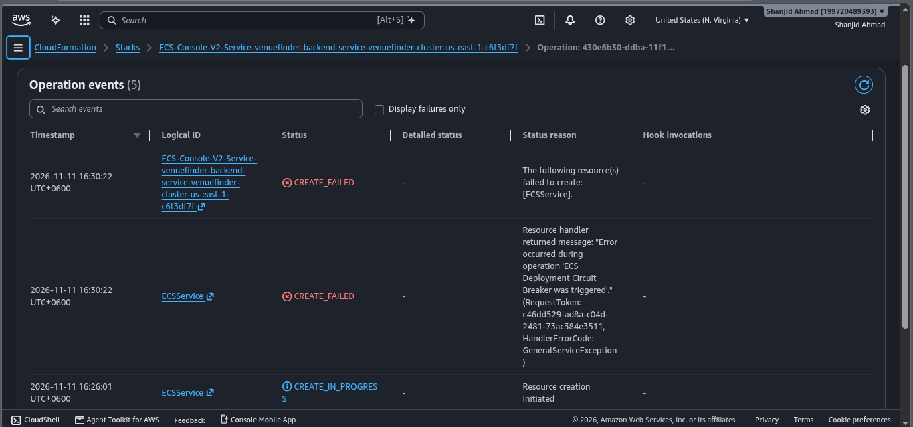
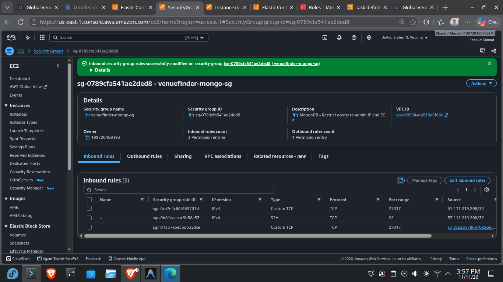
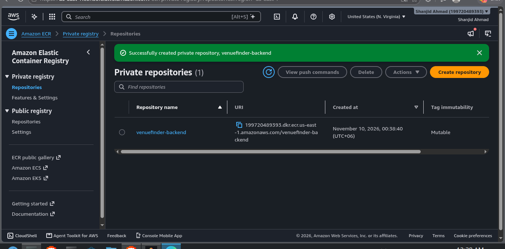
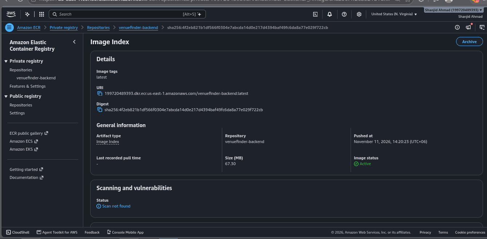
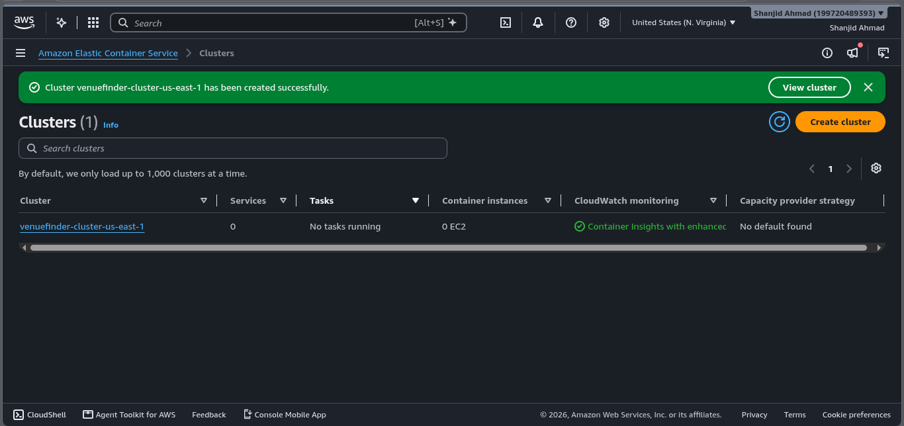
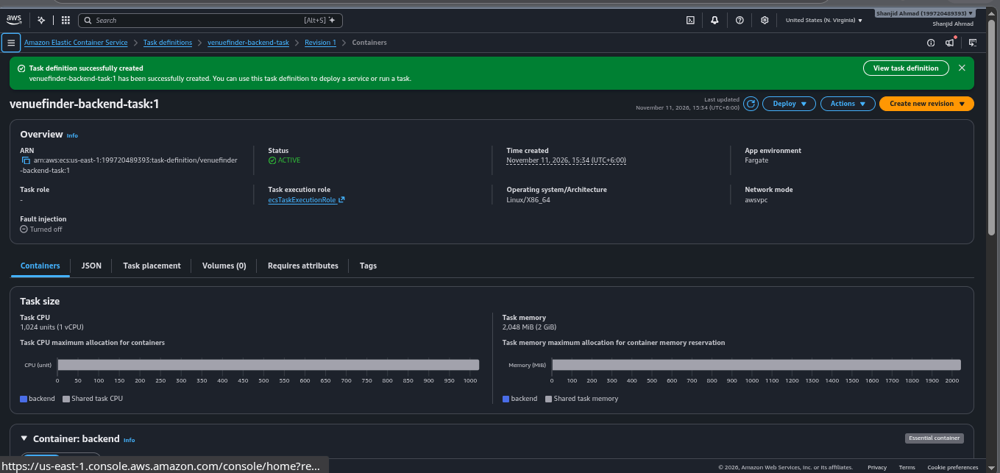

# Phase 3: Container Registry & Compute (ECR & ECS)

**Status:** ✅ Complete  
**Dates:** November 10 – November 11, 2026  
**Time invested:** ~8 hours (mostly debugging network/security group issues)  
**Cost impact:** ~$9.00 / month (ECS Fargate 0.5 vCPU, 1GB RAM, running 24/7)  

---

## 📌 Context
This phase takes the local Dockerized Express backend and deploys it to AWS. We utilized Amazon Elastic Container Registry (ECR) to store the Docker image and Amazon Elastic Container Service (ECS) with AWS Fargate to run it serverless. This provides a highly available, serverless compute layer for the application without the need to manage EC2 worker nodes.

## 🎯 Objectives
- [x] Create a private Amazon ECR repository and push the backend image.
- [x] Create an ECS Fargate Cluster in `us-east-1`.
- [x] Create an IAM Task Execution Role for Fargate.
- [x] Write a Task Definition with environment variables injected.
- [x] Provision an ECS Service to run and maintain the task.
- [x] Verify the container connects to the MongoDB database.

---

## 🔨 Implementation Summary

1. **ECR:** Built the `venuefinder-backend` image using a multi-stage Dockerfile (Node.js 22-alpine) and pushed it to a private ECR repository.
2. **ECS Cluster:** Provisioned a Fargate cluster (`venuefinder-cluster-v2`) without Container Insights (to save CloudWatch costs).
3. **Task Definition:** Configured a Fargate task (0.5 vCPU, 1GB RAM) mapping port 5000. Injected the production `MONGO_URI` and JWT secrets directly into the environment variables.
4. **ECS Service:** Created a Replica service to maintain 1 running task.

---

## 🐛 The Full Struggle: Failures & Fixes

This phase was a masterclass in cloud networking and IAM troubleshooting. The deployment failed across multiple attempts, requiring a deep dive into AWS networking layers.

### Failure 1: ECR Access Denied (IAM)
- **Symptom:** Running `docker login` to ECR resulted in `AccessDeniedException: User ... is not authorized to perform: ecr:GetAuthorizationToken`.
- **Root Cause:** The active IAM user (`pipeline-dev`) lacked the necessary ECR permissions.
- **Fix:** Attached the `AmazonEC2ContainerRegistryFullAccess` policy to the IAM user in the console.




### Failure 2: Security Group UI Constraints
- **Symptom:** Attempting to add the ECS Security Group as a source in the MongoDB Security Group returned: *"CIDR block, a security group ID or a prefix list has to be specified"* and *"You may not specify a referenced group id for an existing IPv4 CIDR rule."*
- **Root Cause:** The AWS Console UI was trying to mix IPv4 rules with Security Group IDs on the same line.
- **Fix:** Clicked "Add Rule" to create a brand new rule line, explicitly changed the Source Type dropdown to "Security Group", and selected the ECS SG.

### Failure 3: The Placeholder Trap
- **Symptom:** Container crashed immediately: `MongoRuntimeError: Unable to parse <EC2_IP>:27017 with URL`.
- **Root Cause:** During Task Definition creation, the literal placeholder text `<EC2_IP>` was left in the `MONGO_URI` instead of the actual database IP.
- **Fix:** Created a new Task Definition revision, replacing the placeholder with the EC2 IP address.

### Failure 4: The Network Abyss (MongooseServerSelectionError)
- **Symptom:** The container would start, but crash after 3 seconds with `MongooseServerSelectionError: Server selection timed out after 3000 ms`. The ECS Deployment Circuit Breaker continuously triggered, rolling back the deployment.
- **Investigation:**
  1. Verified the Docker container was running inside the EC2 instance.
  2. Verified the ECR image pulled successfully (proving outbound ECS internet access).
  3. Checked VPC Route Tables, NACLs, and Subnets (all correctly configured with `0.0.0.0/0 -> igw-`).
  4. Suspected AWS Hairpin NAT limits, so switched the `MONGO_URI` from the EC2 Public IP to the **Private IP (`172.31.31.52`)**.
- **The Ultimate Root Cause:** **Security Group Mismatch.** During Phase 2, we created `venuefinder-mongo-sg`. However, when the EC2 instance was launched, it was accidentally attached to the default `launch-wizard-1` security group. We were meticulously adding the ECS Security Group rule to `venuefinder-mongo-sg`, but the actual server was using `launch-wizard-1`. The real database firewall was silently dropping the traffic.
- **Fix:** Went to the EC2 instance, identified the *actually attached* security group (`launch-wizard-1`), and added an inbound rule for port `27017` allowing the ECS Security Group (`sg-0c6265786e10a5ce6`). Forced a new ECS deployment. The connection was instantaneous.





---

## 🤔 Key Decisions (ADRs)

| Decision | Alternatives Considered | Why This Way | Tradeoff Accepted |
| :--- | :--- | :--- | :--- |
| **AWS Fargate** | EC2 Launch Type / EKS | Eliminates server management overhead. Pay only for the exact vCPU/RAM requested. EKS costs $73/mo just for the control plane. | Slightly higher compute cost per hour vs. raw EC2. |
| **Private IP for DB Routing** | Public IP / NAT Gateway | Avoids AWS Hairpin NAT issues and keeps database traffic entirely on the private AWS backbone. | Cannot easily connect to the database from outside the VPC without a VPN/Bastion. |
| **Task Execution Role** | Hardcoded credentials | `ecsTaskExecutionRole` allows Fargate to pull from ECR and push to CloudWatch securely. | Requires strict IAM permission management. |
| **Image Naming Parity (`venuefinder-backend`)** | Region-specific prefixing | Direct 1:1 mapping between local builds, ECR repo, and ECS task definitions ([ADR-0003](../decisions/0003-image-naming-convention-ecr.md)). | Requires replication configuration for secondary region (`eu-west-1`). |

---

## ✅ Verification & Evidence

- [x] **ECR Repository & Push:** Image tagged and pushed to `199720489393.dkr.ecr.us-east-1.amazonaws.com/venuefinder-backend:latest`.
- [x] **ECS Cluster Created:** Fargate cluster `venuefinder-cluster-v2` active in `us-east-1`.
- [x] **Task Definition Configured:** Port 5000 and container resources verified.
- [x] **ECS Service Status:** Service reaches `1/1` running tasks without circuit breaker trip.
- [x] **CloudWatch Logs:** Logs clearly confirm live MongoDB connectivity and server bootstrap:
  ```json
  {"level": "INFO", "message": "Connected to MongoDB"}
  {"level": "INFO", "message": "Server running on http://localhost:5000"}
  ```






---

## 📊 Metrics
- **Resources created:** 1 ECR Repo, 1 ECS Cluster, 2 Task Definitions, 1 ECS Service, 1 IAM Role.
- **Monthly cost delta:** ~$9.00 (Fargate).
- **Issues encountered:** 4 major blockers (IAM, UI, Placeholder, Security Group).
- **Time lost to SG mismatch:** ~4 hours.
- **Deployment health:** 100% stable after SG attachment fix.

---

## 🎓 What I Learned (SRE Concepts)
- **Security Group Attachment:** Creating a security group does not mean it is active. You must verify which SG is actually attached to the EC2 instance's elastic network interface (ENI).
- **Hairpin NAT:** Routing from a public resource to another public resource *in the same VPC* can be unreliable. Always use Private IPs for internal VPC communication.
- **Circuit Breaker Mechanics:** ECS circuit breakers require a healthy previous deployment to roll back to. If you use `:latest` tags, the "rollback" will just pull the exact same broken image. Immutable tags are required for reliable rollbacks.
- **SRE Persistence:** Diagnosing network timeouts requires systematically eliminating variables (NACLs, Subnets, Route Tables, SGs) until the true culprit is found.
- **Orphaned Resources & Dependency Trees:** In AWS, deleting a service (like ECS) does not cascade to delete the surrounding infrastructure (IAM roles, log groups, security groups). As an SRE, you must understand this dependency tree to prevent "zombie" resources from silently accumulating and costing money. For this project, we reused the IAM roles, security groups, and task definitions to save time and reduce sprawl.

