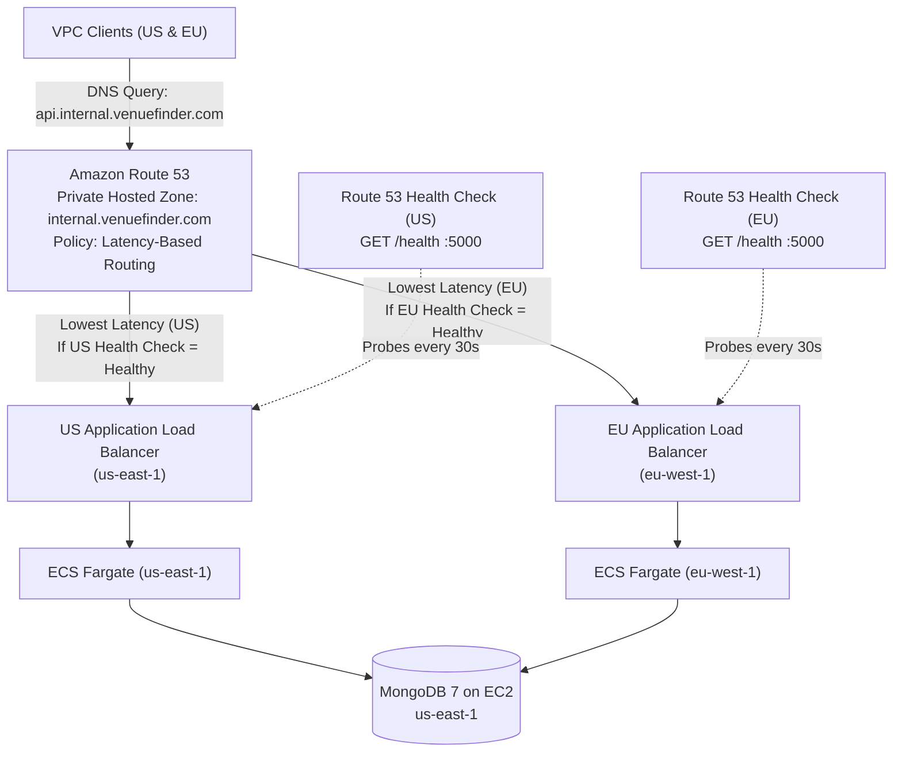
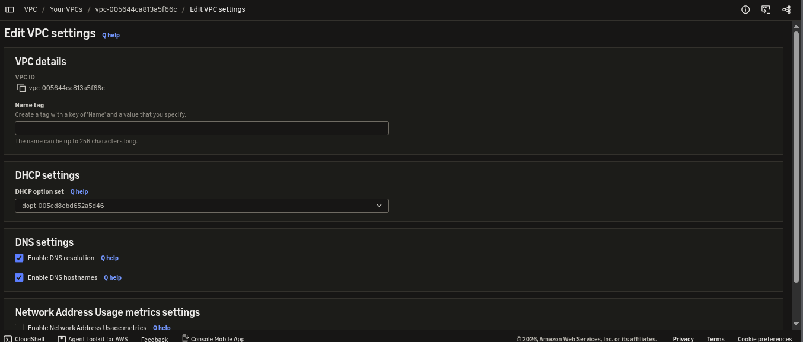
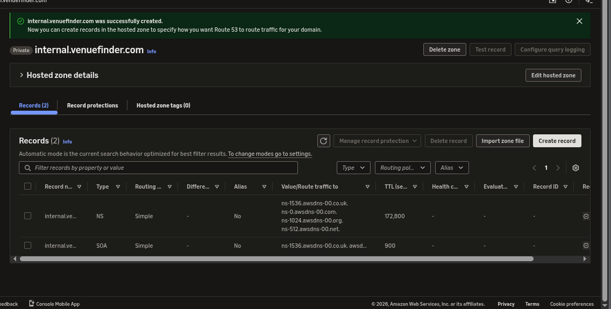
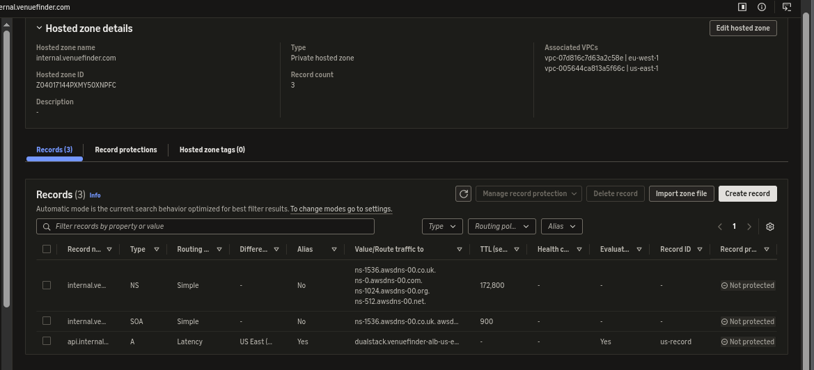
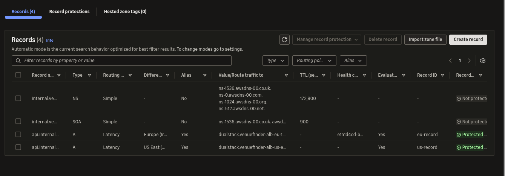

# Phase 4 (Part 2): Global DNS & Traffic Routing (Amazon Route 53)

**Status:** ✅ Complete  
**Dates:** November 13, 2026  
**Target Domain:** `api.internal.venuefinder.com` (Private Hosted Zone)  
**Regions:** `us-east-1` (N. Virginia) & `eu-west-1` (Ireland)  
**Cost impact:** ~$0.50 / month (1x Private Hosted Zone) + ~$1.00 / month (2x Health Checks) = ~$1.50/mo  

---

## 📌 Context
With stateless Express backends running on ECS Fargate behind regional Application Load Balancers in both `us-east-1` and `eu-west-1` (completed in [Phase 4 Part 1](./phase-04-part1-load-balancing.md)), we needed a single, intelligent global entrypoint that routes clients to the lowest-latency region and automatically fails over if an entire AWS region degrades.

---

## 🌐 What is Amazon Route 53?

Amazon Route 53 is a highly available and scalable cloud **Domain Name System (DNS) web service**. In simple terms, it acts as the internet's phonebook. Its primary job is to translate human-friendly domain names (like `api.internal.venuefinder.com`) into the numerical IP addresses (or AWS resource aliases) that computers use to connect to each other.

It is a fundamental building block for any internet-facing or multi-region application on AWS, designed to route end users to your application reliably and cost-effectively.

### ⚙️ Core Benefits of Route 53

1. **High Availability & Scalability:** Route 53 is built on a global network of anycast DNS servers backed by a **100% availability SLA**. It handles massive query volumes without manual scaling.
2. **Traffic Management:** Offers advanced **routing policies** (Latency, Failover, Geolocation, Weighted, Multivalue) to intelligently distribute traffic across global infrastructure.
3. **Health Checks & Failover:** Continuously probes your endpoints (such as regional ALBs at `/health`). If an endpoint becomes unhealthy, Route 53 automatically withdraws it from DNS answers and routes users to a healthy alternative—the cornerstone of **fault-tolerant, highly available architectures**.
4. **Deep AWS Integration:** Integrates natively with ALBs, CloudFront, S3, and EC2 via zero-cost Alias records.
5. **Private DNS for VPCs:** Using **Private Hosted Zones**, teams can manage custom domain names for internal AWS resources without exposing DNS records to the public internet, enhancing security and simplifying service discovery.

### 🎯 Key Use Cases

- **Multi-Region Architectures:** Using **Latency-Based Routing**, Route 53 automatically directs users to the AWS Region that provides the lowest network round-trip latency.
- **Disaster Recovery:** Combining **Failover Routing** (or Latency + Health Checks) creates active-active or active-passive topologies that redirect traffic away from degraded regions automatically.
- **Internal Service Discovery:** **Private Hosted Zones** give internal microservices and databases memorable DNS names resolvable strictly inside associated VPCs.
- **A/B Testing & Canary Deployments:** **Weighted Routing** shifts a small percentage of traffic to a new release before a full global rollout.

---

## 🏗️ Global Routing Topology

---

## 🎯 Objectives
- [x] Enable DNS resolution and DNS hostnames on both `us-east-1` and `eu-west-1` VPCs.
- [x] Create a Private Hosted Zone (`internal.venuefinder.com`) associated with both regional VPCs.
- [x] Provision independent Route 53 Health Checks probing `/health` on each regional ALB.
- [x] Create Latency-Based `A` Alias records for `api.internal.venuefinder.com` in both `us-east-1` and `eu-west-1`.

---

## 🔨 Step-by-Step Breakdown of Our Route 53 Implementation

### Step 1: Enable DNS Settings on Both VPCs
- **Action:** For both the US (`us-east-1`) and EU (`eu-west-1`) default VPCs, verified and enabled **DNS resolution** (`enableDnsSupport`) and **DNS hostnames** (`enableDnsHostnames`).
- **Reason:** This is a critical prerequisite. A Private Hosted Zone is only resolvable from within associated VPCs. For Route 53 to resolve records in a private zone, the VPC's internal AmazonProvidedDNS resolver must be active.
- **Result:** Both regional VPCs were enabled for split-horizon private DNS resolution.
- **Evidence:** 

### Step 2: Create the Private Hosted Zone
- **Action:** Created a Private Hosted Zone for `internal.venuefinder.com` and associated it with **both** the `us-east-1` VPC and the `eu-west-1` VPC.
- **Reason:** Without purchasing a public domain, a Private Hosted Zone demonstrates Route 53's full routing policies and health-check integration at near-zero cost (`$0.50/mo`). Multi-VPC association ensures compute in Virginia and Ireland resolve the exact same domain name consistently.
- **Result:** Established the unified `internal.venuefinder.com` DNS namespace across both continents.
- **Evidence:** 

### Step 3: Create the US Latency Record & Health Check
- **Action:** Created an `A` Alias record for `api.internal.venuefinder.com` with **Routing Policy = Latency** (`us-east-1`), targeting the US ALB, and linked a dedicated Route 53 Health Check probing `GET /health`.
- **Reason:** Latency-Based Routing instructs Route 53 to serve the endpoint offering the lowest estimated network latency. Attaching the `/health` check verifies the **entire stack**—ALB reachability, ECS container responsiveness, and active MongoDB `admin().ping()` connectivity.
- **Result:** North American traffic resolves to `us-east-1` with automated health verification.
- **Evidence:** 

### Step 4: Create the EU Latency Record & Health Check
- **Action:** Created a second `A` Alias record for `api.internal.venuefinder.com` with **Routing Policy = Latency** (`eu-west-1`), targeting the EU ALB, paired with its own independent Route 53 Health Check.
- **Reason:** Completes the active-active multi-region routing matrix so European traffic resolves locally to Ireland while retaining automatic cross-Atlantic failover.
- **The Critical SRE Lesson (Health Check Separation):** We initially attempted to reuse the US health check for the EU record and immediately corrected this. **Each regional endpoint must have its own independent health check.** If both records share one health check and the US ALB fails, the single health check turns `Unhealthy` and Route 53 removes *both* the US and EU records—taking the entire global application offline.
- **Result:** Route 53 maintains two independent, health-checked latency targets for `api.internal.venuefinder.com`.
- **Evidence:** 

---

## 🐛 Failures & Troubleshooting (SRE Mindset)

### Failure 1: AWS Console Health Check UI Bug
- **Symptom:** When creating the EU Health Check in the AWS Route 53 Console, the UI failed to render the **Port** and **Path** input fields, preventing configuration of `:5000` and `/health`.
- **Root Cause:** Transient AWS Console frontend rendering defect.
- **Fix:** Bypassed the UI completely and dropped down to the **AWS CLI** (`aws route53 create-health-check`), passing a precise JSON specification for endpoint FQDN, port, HTTP protocol, and `/health` resource path.
- **Lesson:** Never let a web console UI bug block infrastructure delivery. Mastering the AWS CLI and declarative JSON/Terraform configurations provides deterministic control over cloud APIs.

### Failure 2: The "Inverted" Health Check Trap
- **Symptom:** Upon inspecting the first CLI/Console-created EU health check, the configuration showed `Inverted: Yes`.
- **Root Cause:** An accidental toggle/flag flipped the health check evaluation logic.
- **Impact if Uncaught:** Route 53 would treat a **healthy** EU ALB as broken and only route traffic to Ireland when the server was **down**, causing total regional blackholing or serving broken endpoints.
- **Fix:** Caught the inversion during post-creation audit, deleted the flawed check, and recreated the EU health check with `"Inverted": false`.
- **Lesson:** Always audit health check boolean semantics (`Inverted`, `EvaluateTargetHealth`) immediately after creation—a single inverted flag silently reverses failover behavior.

---

## 🤔 Key Decisions (ADRs)

| Decision | Alternatives Considered | Why This Way | Tradeoff Accepted |
| :--- | :--- | :--- | :--- |
| **Private Hosted Zone (`internal.venuefinder.com`)** | Public Hosted Zone + Purchased Domain | Eliminates domain registration cost while demonstrating full Route 53 Latency Routing, multi-VPC association, and Health Check integration. | Resolution is scoped to associated VPCs rather than the public internet. |
| **Latency-Based Routing Policy** | Geolocation / Weighted / Simple | Automatically adapts to real-time AWS network telemetry rather than static country maps or fixed percentages. | Requires healthy endpoints in both regions for optimal routing. |
| **Independent Health Checks per Region** | Shared Health Check | Isolates blast radius: a `us-east-1` outage will not evict the healthy `eu-west-1` DNS record. | Doubles health check cost (~$0.50/mo $\rightarrow$ ~$1.00/mo), trivial compared to global outage risk. |

See formal record: [ADR-0004: Route 53 Private Hosted Zone & Latency-Based Routing](../decisions/0004-route53-private-hosted-zone-latency-routing.md).

---

## ✅ Verification & Evidence

- [x] **VPC DNS Support Active:** `docs/screenshots/36a-success-vpc-dns-settings.png`
- [x] **Private Hosted Zone Multi-VPC Association:** `docs/screenshots/36-success-route53-private-zone.png`
- [x] **US Latency Record & Health Check:** `docs/screenshots/37-success-route53-us-latency-record.png`
- [x] **EU Latency Record & Health Check:** `docs/screenshots/38-success-route53-eu-latency-record.png`

---

## 📊 Metrics
- **Resources created:** 1 Private Hosted Zone (`internal.venuefinder.com`), 2 Latency Alias `A` Records, 2 Independent Route 53 Health Checks.
- **Monthly cost delta:** ~$1.50 / month.
- **Issues encountered:** 2 (Console UI field bug, Inverted health check flag).
- **Failover blast-radius isolation:** 100% decoupled per region.

## 🎓 What I Learned
- **DNS is Application Control Plane:** Route 53 is not just static name resolution—combined with deep `/health` checks (which verify MongoDB `admin().ping()`), DNS becomes an active global traffic controller.
- **Blast Radius Isolation in Health Checks:** Never share a single health check across independent regional records; shared checks create a single point of failure that defeats multi-region redundancy.
- **CLI Over Console:** When the AWS Console UI misbehaves, dropping directly to the AWS CLI (`aws route53 create-health-check`) is faster, repeatable, and scriptable.

