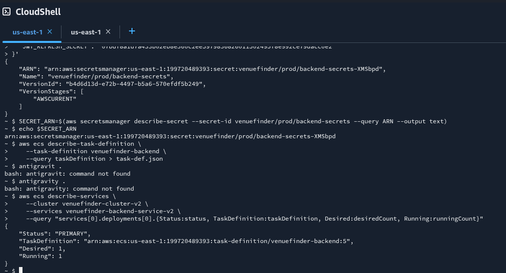
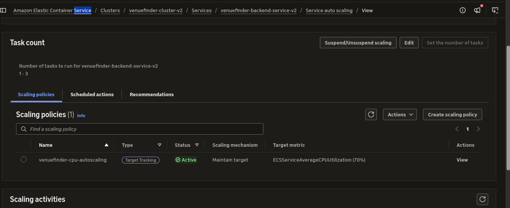

# Phase 7: Hardening & Scaling

**Status:** ✅ Complete (with one deferred task)
**Dates:** November 14, 2026
**Time invested:** ~1.5 hours
**Cost impact:** ~$0.40 / month (Secrets Manager) + Variable (Auto-scaling)

## 📌 Context
The application was fully functional and automated, but it lacked production-grade security and scalability. In this final technical phase, we removed plaintext secrets from the ECS Task Definitions and implemented auto-scaling to handle traffic spikes dynamically.

## 🎯 Objective
- [x] Store database credentials and JWT secrets in AWS Secrets Manager.
- [x] Update IAM roles to allow ECS to read from Secrets Manager.
- [x] Modify the ECS Task Definition to inject secrets at runtime.
- [x] Configure Target Tracking Auto-Scaling on the US ECS Service.
- [~] Enable ECR Image Scanning (Deferred - see failures).

---

## 🔨 Implementation Summary

1.  **Secrets Manager (via CloudShell):** Created a secure secret (`venuefinder/prod/backend-secrets`) containing the Mongo URI and JWT secrets. Attached the `SecretsManagerReadWrite` policy to the `ecsTaskExecutionRole`.
2.  **Task Definition Update:** Edited the Task Definition JSON to remove the plaintext `environment` variables and replaced them with a `secrets` array referencing the Secrets Manager ARN.
3.  **Auto-Scaling:** Registered a scalable target for `venuefinder-backend-service-v2` (min: 1, max: 3) and created a Target Tracking Policy to scale out if CPU utilization exceeds 70%.

---

## 🐛 Failures, Fixes & Deferred Tasks

### Failure 1: ECR Scan Rejects OCI Image Index (Deferred)
**Symptom:** Attempting to manually scan the ECR image resulted in `UnsupportedImageTypeException: An artifact with media type 'application/vnd.oci.image.index.v1+json' cannot be scanned`.
**Root Cause:** Modern Docker BuildKit (used by default on newer Docker installations) compiles images into an OCI (Open Container Initiative) index format. AWS ECR's basic vulnerability scanner only supports the older Docker V2 manifest format.
**Resolution:** Deferred. Rebuilding the image with legacy build flags (`DOCKER_BUILDKIT=0`) would fix it, but it was deprioritized to maintain momentum. Documented as technical debt. A long-term fix would be to enable **AWS Inspector** for ECR, which supports OCI formats.

### Failure 2: Secret Already Exists
**Symptom:** `ResourceExistsException` when trying to create the secret via CLI.
**Root Cause:** A secret with the same name was partially created during a previous console session.
**Fix:** Used `aws secretsmanager put-secret-value` to overwrite the existing secret instead of creating a new one.

---

## ✅ Verification & Evidence

- [x] **Secrets Manager:** The active Task Definition shows no plaintext passwords in the Environment Variables tab, and successfully fetches them from Secrets Manager.
- [x] **Auto-Scaling:** The ECS Service Auto Scaling tab shows the active policy targeting 70% CPU utilization.

---

## 🎓 What I Learned
1.  **Runtime Secret Injection:** Storing secrets in a Task Definition is a massive security anti-pattern. Secrets Manager prevents anyone with read-access to the ECS console from stealing database credentials.
2.  **Cost-Aware Scaling:** Setting the Auto-Scaling minimum to 1 task ensures we aren't paying for idle compute, while the maximum of 3 ensures the app won't crash during a viral traffic spike.
3.  **Docker Image Formats:** Learned the difference between Docker V2 and OCI image manifests, and how BuildKit changes the output format of images.

